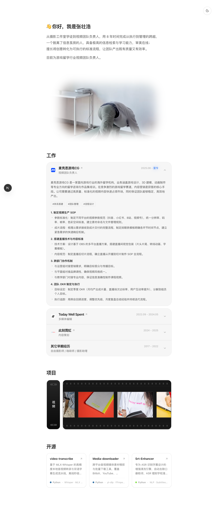
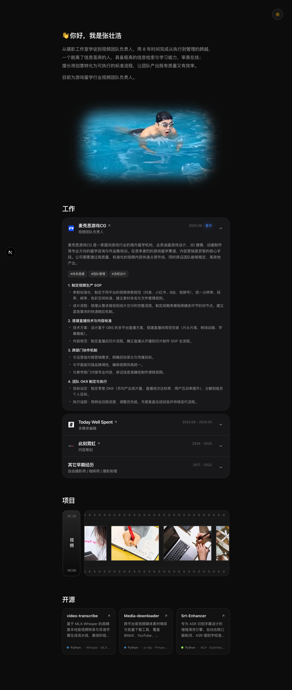

# Rubber's Portfolio

张橡胶（Rubber）的个人作品集与数字空间。

视觉风格与交互排版灵感源自 [kshv.me](https://www.kshv.me/)。

---

## 界面预览

| 亮色模式 | 暗色模式 |
| :---: | :---: |
|  |  |

---

## 引用的组件库

项目中部分交互与组件灵感及实现引用自以下开源项目：

- [21st.dev](https://21st.dev/)
- [starc007/ui-components](https://github.com/starc007/ui-components)
