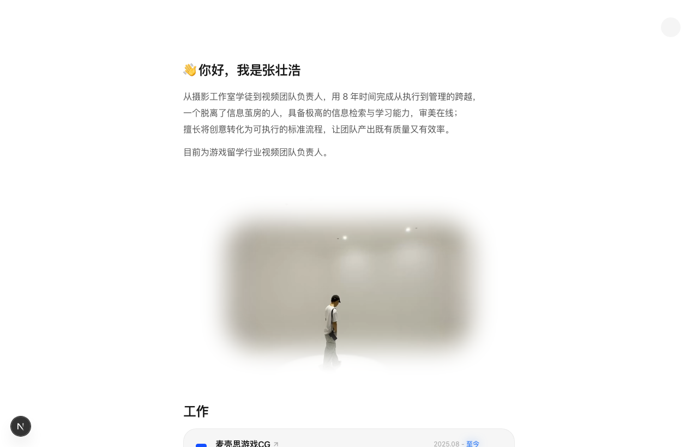

# Rubber's Portfolio

张橡胶（Rubber）的个人作品集与数字空间。记录视频团队管理、商业与个人摄影、设计系统以及开源工具。

整体交互与极简排版灵感源自 [kshv.me](https://www.kshv.me/)。

---

## 界面预览（日夜对照）

| 亮色模式 (Light Mode) | 暗色模式 (Dark Mode) |
| :---: | :---: |
|  |  |

---

## 技术栈与开源组件库

本项目基于 Next.js App Router 架构开发，核心交互与动效依赖以下开源组件库与图形引擎：

- **核心框架**
  - [Next.js](https://github.com/vercel/next.js) — 采用 App Router 与 Turbopack 驱动的 React 生产全栈框架，实现纯静态 SSG 导出与秒级构建。
  - [React 19](https://github.com/facebook/react) — 核心视图层与 UI 状态调度。

- **交互动效与 3D 物理模拟**
  - [Motion (Framer Motion)](https://github.com/motiondivision/motion) — 驱动双 35mm 胶卷手风琴推拉动效、分类胶囊连体弹性滑动（`layoutId`）、灯箱过渡及手势拖拽。
  - [Three.js](https://github.com/mrdoob/three.js) — 用于页脚 3D 揉纸团（Crumpled Paper）的网格撕裂、物理形变与展平展开模拟，支持离开视口自动挂起。
  - [GSAP](https://github.com/greensock/GSAP) — 用于高性能物理视差与时间线精确控制。

- **UI 样式与图标**
  - [Tailwind CSS v4](https://github.com/tailwindlabs/tailwindcss) — 新一代高性能原子化 CSS 引擎，全面拥抱 CSS 原生变量与极简配置。
  - [Lucide Icons](https://github.com/lucide-icons/lucide) — 统一、清晰的轻量矢量图标库。
  - [next-themes](https://github.com/pacocoursey/next-themes) — 暗黑模式切换系统，结合 Chrome/Safari 原生 View Transitions API 打造圆形扩散切光特效。

- **图像与媒体优化**
  - [Sharp](https://github.com/lovell/sharp) — 构建期全自动增量扫描 200+ 张高分辨率摄影作品，秒级生成 480px WebP 缩略图，大幅削减带宽并消除相册切换掉帧。

---

## 本地开发与构建

```bash
# 安装依赖
npm install

# 启动本地开发服务 (支持缩略图生成与热重载)
npm run dev

# 增量生成 WebP 缩略图并构建生产静态包
npm run build
```
